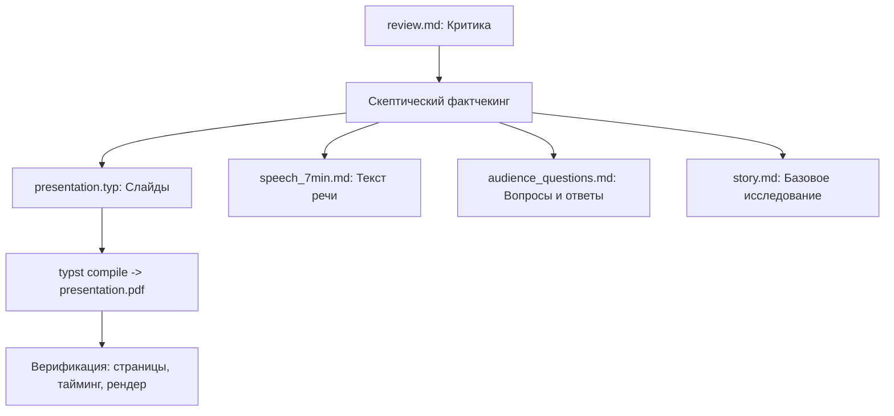

# План действий по учету критики доклада (review.md)

## Описание целей и аналитический подход
В рецензии [`review.md`](file:///home/nomen/Projects/rights-and-anticorruption-actions-report/review.md) содержится детальный критический разбор доклада, слайдов (`presentation.typ`), текста речи (`speech_7min.md`) и базисного документа (`story.md`). 

Задача: **подойти к критике с научной строгостью и здоровым скептицизмом**:
1. Безоговорочно принять и исправить обоснованные замечания по фактологии, датировкам и терминологии.
2. Не принимать ошибочные утверждения самого рецензента (в частности, о Судебнике 1497 года), но использовать их для усиления академической доказательности.
3. Сохранить авторский живой формат, мемы и динамику 7-минутного выступления, подняв научную планку содержательной части до неуязвимого уровня.

---

## Анализ критики: разделение на категории

### Категория 1. Справедливая критика: исправляем обязательно

1. **Реформы княгини Ольги (даты и суть):**
   * *Критика:* 945 г. — гибель Игоря; уставы и уроки в Древлянской земле введены в **946 г.**, а погосты и дани/оброки по Мсте и Луге — в **947 г.**
   * *Вердикт:* **Принять 100%.** Исправляем дату на слайде и в тексте на «946–947 гг.» с разведением мероприятий.
2. **Терминологическая ошибка в Судебнике 1550 г. («лишение сана»):**
   * *Критика:* На слайде 19 указано «лишение сана» для бояр-судей. Боярство — сословный чин, а не церковный сан.
   * *Вердикт:* **Принять 100%.** По ст. 3 Судебника 1550 г. боярин обязан возместить иск, уплатить тройные пошлины и подпадает под царскую опалу («а в пене что государь укажет»). Формулировку «лишение сана» убираем.
3. **Псевдоцитата Сигизмунда Герберштейна («не помажешь колеса»):**
   * *Критика:* Фраза про «смазку колес» взята в кавычки как прямая цитата, но является русской пословицей/пересказом.
   * *Вердикт:* **Принять.** В «Записках о Московии» описан реальный исторический случай: судья взял взятки с обеих сторон, вынес решение в пользу богатого, а великий князь Василий III лишь посмеялся и отпустил его. Замена вымышленной пословицы на этот подлинный исторический анекдот сделает выступление ярче и научнее.
4. **Неточная цитата Двинской уставной грамоты 1397 г.:**
   * *Критика:* Фраза *«А наместники и их тиуны посулов в суде не емлют»* отсутствует в тексте грамоты.
   * *Вердикт:* **Принять.** В грамоте содержатся конкретные статьи: штраф 4 рубля за отпуск вора за взятку (*«самосуд»*) и запрет вымогать взятку с арестованного в оковах (*«а посула в железех не просити; а что в железех посул, то не в посул»*). Даем точные цитаты.
5. **Привязка злоупотреблений доводчиков к уставным грамотам:**
   * *Критика:* Произвол доводчиков и «поверстные пошлины» были помещены в XII–XIII вв., хотя ключевые источники их регламентации — это уставные грамоты конца XIV–XV вв. (Белозерская 1488 г., Двинская 1397 г.).
   * *Вердикт:* **Принять.** В Белозерской грамоте 1488 г. зафиксированы уникальные детали (доводчику запрещено ездить более чем на 1 лошади, запрещено обедать там, где ночует, чтобы не объедать волость). Привязка к памятникам XV в. делает аргумент железобетонным.
6. **Методологическая рамка:**
   * *Критика:* Слова «коррупция», «лихоимство» и «общественный договор» звучат так, будто князья и древляне читали современный УК РФ.
   * *Вердикт:* **Принять.** Четко зафиксировать во введении: это наша современная институциональная оптика; для средневековья это были обычаи содержания власти и традиционные дары, границы которых лишь постепенно криминализировались.

---

### Категория 2. Ошибки и заблуждения самого рецензента (наш скептицизм)

1. **Судебник 1497 года: Статья 1 против Статьи 67**
   * *Утверждение рецензента:* 
     > «Запрет посулов содержится не в статье 1, а в статье 67 Судебника. Поэтому нельзя делать вывод об отсутствии санкции, сославшись только на статью 1. Распространённое изложение указывает, что статья 67 предписывала взыскивать штрафы за посулы...»
   * *Фактическая проверка по первоисточнику («Российское законодательство X–XX вв.», Т. 2):*
     * **Статья 1:** *«Судити суд бояром и околничим. А на суде быти диаком. А посулов бояром, и околничим, и диаком от суда и от печалованиа не имати, также и всякому судье посула от суда не имати...»* — **запрет судьям содержится именно в статье 1!**
     * **Статья 67:** *«О посулех и о послушестве... да велети прокликать по торгом... чтобы ищея и ответчик судиам и приставом посулу не сулили в суду, а послухом не видев не послушествовати... А послуствует послух лживо... ино на том послухе гибель исцева вся и с убыткы»*.
     * **Вывод:** Рецензент грубо ошибся! Ст. 67 налагает штраф («гибель исцева») **исключительно на лжесвидетелей (послухов)**, а не на судей! Для судей, взявших посул, ни ст. 1, ни ст. 67 **действительно не устанавливают уголовной санкции** (в отличие от Судебника 1550 г., ст. 3–5).
   * *Наше решение:* Мы не просто защищаем наш тезис о «парадоксе 1497 года», а цитируем **обе статьи (ст. 1 и ст. 67)**, наглядно показывая, что запрет оглашался на торгах, но судейской уголовной ответственности кодекс так и не установил. Это полностью нейтрализует замечание.

2. **Срок кормления «1–2 года»**
   * *Утверждение рецензента:* Универсальный срок «1–2 года» не доказан и не должен подаваться как общее правило.
   * *Фактическая проверка:* В.О. Ключевский («Курс русской истории», Т. 2) и А.К. Леонтьев прямо фиксируют практику назначения кормленщиков на 1–2 года («покормится наместник год или два...»). Справедливость критики лишь в том, что это правило оформилось в XIV–XV вв., а не в XII в.
   * *Наше решение:* Мы сохраняем тезис о ротации на 1–2 года и краткосрочном горизонте планирования, но связываем его со зрелой системой кормлений (XIV–XV вв.), как это и описывал Ключевский.

---

### Категория 3. Стилистика, мемы и регламент 7 минут

* *Предложение рецензента:* «Убрать слайды-разделители с одиночным словом "Кормление" и мемы без самостоятельной функции... убрать шутки про запертую аудиторию».
* *Контраргумент и позиция:* 
  Доклад готовится студентом для семинара с живой аудиторией сверстников. Сухой монолог по нормативным актам через 3 минуты приведет к потере внимания зала. 
  Мемы («stop arguing», «rich man / poor man», «Мавроди / Капибара-Калита») идеально ритмизируют рассказ, подчеркивая переход мысли. 
  **Решение:** Мемы и разделители **сохраняем**, но усиливаем научную доказательность и фактологию на текстовых слайдах. Шутку во введении можно слегка облагородить, сохранив обаятельную иронию.

---

## Предлагаемые изменения по файлам



---

### 1. `presentation.typ` (Слайды)

#### [MODIFY] `presentation.typ`
* **Слайд 2 (Определения / Методология):** Добавить краткую плашку-дисклеймер: *«Историко-правовая оптика: термины "коррупция" и "лихоимство" используются как ретроспективные аналитические категории»*.
* **Слайд 5 (Полюдье и Ольга):**
  * Заголовок и бейдж: исправить на `946–947 гг.`
  * Развести реформу: 946 г. — *уроки и уставы* у древлян; 947 г. — *погосты и дани* на севере (Мста и Луга).
* **Слайды 9–10, 12 (Кормления и приказной аппарат):**
  * Уточнить хронологию срока «1–2 года»: указать как практику развитого наместничества (XIV–XV вв., по В.О. Ключевскому).
  * В слайде про тиунов и доводчиков добавить точную ссылку на **Белозерскую уставную грамоту 1488 г.** (ограничение до 1 коня, запрет постоя и накрутки верст).
* **Слайды 14–15 (Орда и Калита):**
  * Смягчить формулировку: восстание 1262 г. привело к ликвидации откупов бесерменов в ключевых городах Северо-Восточной Руси;
  * Иван Калита: указать как историографическую гипотезу (Борисов, Ключевский vs Горский) — постепенный фискальный маневр, а не мгновенный декрет в один день 1328 г.
* **Слайд 18 (Двинская грамота и Судебник 1497 г.):**
  * Исправить цитату Двинской грамоты: привести подлинные нормы о «посуле в железех» и «самосуде» (ст. 6).
  * **Судебник 1497 года:** четко указать обе статьи — **ст. 1** (запрет судьям-боярам и дьякам брать посулы) и **ст. 67** (оглашение запрета на торгах, при этом штраф установлен лишь для лжесвидетелей-послухов; судья оставался вне уголовной санкции).
  * Заменить псевдоцитату Герберштейна на исторический факт из «Записок о Московии» (анекдот о судье, взявшем посулы с двух сторон).
* **Слайд 19 (Судебник 1550 г. и Иван Грозный):**
  * Убрать «лишение сана»! Заменить на: *«ст. 3: возмещение иска, тройные пошлины и царская опала»*.
  * Для дьяков — тюрьма (ст. 4), для подьячих — торговая казнь кнутом (ст. 5).

---

### 2. `speech_7min.md` (Текст речи на 7 минут)

#### [MODIFY] `speech_7min.md`
* Синхронизировать текст речи со всеми уточненными слайдами.
* Во введении четко произнести методологическую оговорку (снимает 90% претензий любого преподавателя).
* В блоке 1497 г. блестяще проговорить: *«Иван III в первой статье запрещает посулы судьям, а в 67-й велит прокликать этот запрет по торгам. Но вот парадокс: санкцию кодекс прописал только для лжесвидетелей, а судье ничего не грозило!»*.
* Вставить рассказ Герберштейна про Василия III и судью вместо пословицы про колеса.
* Проконтролировать тайминг: объем речи удержать в диапазоне ~820–880 слов (комфортный темп на 7 минут).

---

### 3. `audience_questions.md` (Вопросы и шпаргалка ответов)

#### [MODIFY] `audience_questions.md`
* Добавить коронный вопрос со звездочкой:  
  *«А почему вы говорите о статье 1 Судебника 1497 года, если о посулах есть статья 67?»*  
  И дать разгромный, академически безупречный ответ со сравнением обеих статей, демонстрирующий превосходное знание текста памятника.
* Уточнить ответы по реформам Ольги (946/947 гг.), Белозерской грамоте 1488 г. и канонам Владимирского собора 1274 г.

---

### 4. `story.md` (Базовый текст доклада и библиография)

#### [MODIFY] `story.md`
* Внести соответствующие коррективы в фактологию и формулировки.
* Добавить ссылки на конкретные статьи памятников права («Российское законодательство X–XX вв.», Т. 2).

---

## План верификации

### 1. Компиляция и сборка
* Скомпилировать Typst-документ:
  ```bash
  /home/nomen/.local/bin/typst compile presentation.typ presentation.pdf
  ```
* Проверить отсутствие ошибок форматирования, переполнения страниц и сдвигов текста.

### 2. Проверка визуального рендера
* Сгенерировать изображения слайдов через `pdftoppm` для ключевых исправленных слайдов (слайды 5, 9, 10, 12, 14, 15, 18, 19).
* Визуально убедиться, что блоки карточек не наезжают друг на друга и верстка выглядит гармонично.

### 3. Хронометраж речи
* Проверить точный объем чистых произносимых слов в `speech_7min.md` через скрипт:
  целевой диапазон — 800–880 слов (при темпе 115–120 слов в минуту это ровно 7 минут).

---

## Вопросы к пользователю и решения, требующие согласования

> [!IMPORTANT]
> **Решение по мемам и слайдам-разделителям:**
> Рецензент настаивал на удалении мемов и разделителя «Кормление». Предлагается **оставить их**, так как они работают на вовлечение аудитории, а научный вес мы полностью закрываем исправлением фактов и статей источников. Вы согласны с сохранением мемов?

> [!NOTE]
> **Замена цитаты Герберштейна:**
> Вместо пословицы про «смазку колес» мы вставляем подлинный исторический анекдот Герберштейна о судье и Василии III. Это одобрено?
